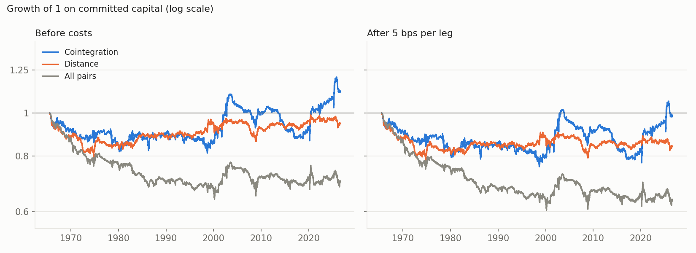

# Does a cointegration screen find pairs worth trading?

[](https://github.com/rxj0102/stat-arb-pairs/actions/workflows/ci.yml)

**Question.** Pairs trading rests on one claim: two prices that moved together in the past will keep doing so, and a gap between them will close. A cointegration test is the standard way to find such pairs. Does a pair that passes the test in one window keep reverting in the next?

<!-- headline:start (generated by scripts/render_readme.py, do not edit by hand) -->
**Answer, over 122 formation and trading periods from 1965 to 2026: barely, and not enough to trade.** The ten most cointegrated pairs of each period earn 0.3% a year before costs and 0.1% after (Sharpe ratio 0.07 and 0.02, neither distinguishable from zero). The screen is not worthless: it beats trading every pair by 0.8% a year (t = 2.1), because trading every pair loses money. But the property it selects on does not last. A pair picked by the screen is still cointegrated in the next two years 9% of the time, against 7% for any pair, and only 31% of the trades it opens converge before the period ends.
<!-- headline:end -->

Every number on this page is written by `scripts/reproduce.py`, and CI fails if the page and the results file disagree.



## Results

<!-- results:start (generated by scripts/render_readme.py, do not edit by hand) -->
Daily returns 1965-07-01 to 2026-07-31 (61 years, 122 periods of 126 trading days, each formed on the 504 days before it). On average 141 within-sector pairs are tested per period. Returns are on committed capital; costs are 5 bps per unit traded per leg; t-statistics use Newey-West errors.

| Portfolio | Return per year, gross | Sharpe, gross | Return per year, net | Sharpe, net | t, net | Max drawdown | Trades that converge |
|---|---|---|---|---|---|---|---|
| Cointegration | +0.27% | +0.07 | +0.06% | +0.02 | +0.14 | -24% | 31% |
| Distance | -0.06% | -0.03 | -0.26% | -0.12 | -0.90 | -22% | 28% |
| All pairs | -0.54% | -0.20 | -0.70% | -0.26 | -2.08 | -40% | 19% |

**Does selection help?** Difference in annual return, with its t-statistic

| Comparison | Gross | Net |
|---|---|---|
| Cointegration minus all pairs | +0.81% (+2.22) | +0.76% (+2.08) |
| Distance minus all pairs | +0.48% (+1.63) | +0.45% (+1.51) |
| Cointegration minus distance | +0.33% (+0.80) | +0.32% (+0.77) |

**Net Sharpe ratio by era**

| Portfolio | 1965-1979 | 1980-1999 | 2000-2012 | 2013-2026 |
|---|---|---|---|---|
| Cointegration | -0.41 | -0.02 | +0.27 | +0.13 |
| Distance | -0.67 | +0.19 | -0.05 | -0.06 |
| All pairs | -1.02 | -0.45 | +0.18 | -0.11 |

**The screen itself.** On average 10.4 pairs per period pass the Engle-Granger test at 5%, where 7.1 would pass by chance alone; the count is above chance in 61% of periods. Of the ten pairs selected in a period, 9.4% pass the same test on the following, non-overlapping 24 months. For all pairs the figure is 7.5% (118 periods).
<!-- results:end -->

## Reading the results

- **The benchmark matters more than the headline.** A pairs backtest is usually compared with zero. The right comparison is trading every pair with the same rule, and that loses money after costs: an industry spread that has opened wide is at least as likely to keep going as to close. Against that benchmark the screen adds something real. Against zero it adds nothing.
- **The test finds more than chance, and what it finds does not last.** More pairs pass than a 5% test would pass by luck, so some cointegration is there in sample. But a selected pair is hardly more likely than any other to pass again on fresh data. The screen is mostly picking pairs that happened to revert during formation.
- **Most trades never converge.** They are closed at the end of the period, still open. That is the mechanical reason the returns are flat: the rule pays when a gap closes, and most gaps do not close in six months.
- **Cointegration is no better than distance.** The simpler selection rule of Gatev, Goetzmann and Rouwenhorst is statistically indistinguishable from the cointegration test here.
- **Returns are tiny even before costs.** On committed capital the best portfolio earns a fraction of a percent a year. Costs are not what kills it.
- **The era table does not show a clean decline.** Published work on single stocks finds pairs profits falling over time. Industry portfolios show no such pattern, and the worst era here is the first.

## Design

| Choice | What and why |
|---|---|
| Universe | The 142 within-sector pairs of the Ken French 49 industry portfolios, daily, value-weighted. |
| Formation | 24 months. Hedge ratio by OLS on log prices, Engle-Granger test with one lag, and the squared distance between the two price paths. |
| Excluded | An industry with missing returns in a window sits that period out. A pair with a negative hedge ratio in formation is not traded. |
| Selection | The 10 pairs with the lowest Engle-Granger p-value; the 10 with the smallest distance; and all pairs as the benchmark. |
| Trading | The next 6 months. The spread is measured in formation standard deviations. Open beyond 2, close when it crosses zero, close everything at the end of the period. |
| Execution | A signal at the close is traded the next day. 5 bps per unit traded per leg. |
| Returns | Per pair on gross exposure; a portfolio is the mean over its pairs including idle ones. |
| Tuning | None. Windows, thresholds and the number of pairs were fixed before the run and nothing was searched. |

## What was wrong with the first version

It screened once on three years and traded once for two: nine pairs passed, where about seven would be expected to pass by chance. No conclusion was possible from that, in either direction. It also carried a Kalman filter hedge ratio, an Ornstein-Uhlenbeck half-life filter, a rolling regime filter and a sensitivity grid, each adding parameters to a sample that could not support one. They are removed. The rebuild keeps a single rule and repeats it on every six month period since 1965.

## Limits

- Industry portfolios are not tradable pairs, and they are far more diversified than two stocks. A stock-level study needs a database with delisted companies, which is not free. The result says cointegration between industries does not persist; it does not say the same of single stocks.
- Six month trading periods and a 2 standard deviation entry are one design. Others were not tried, on purpose.
- Costs are a flat 5 bps and ignore financing and short borrow.
- The Engle-Granger test uses one lag for speed and for a fixed specification.

## Reproduce

```bash
pip install -r requirements.txt
python -m pytest -q               # tests
python scripts/reproduce.py       # about a minute, rewrites results/
python scripts/render_readme.py   # rewrites this page; --check compares only
```

Returns are frozen in `data/snapshot/industry_returns.csv.gz`. `python -m universe.opendata` downloads them again from the Ken French Data Library.

## Layout

```
study.py                 formation statistics, the trading rule, the rolling run, persistence
universe/sector_map.py   the eight sectors that define which pairs are tested
universe/opendata.py     Ken French Data Library loader
scripts/                 reproduce.py writes results/, render_readme.py writes this page
tests/test_study.py      look-ahead, trading rule and accounting checks
```

## References

- Do, B. and Faff, R. (2010). Does simple pairs trading still work? *Financial Analysts Journal* 66(4).
- Engle, R. and Granger, C. (1987). Co-integration and error correction. *Econometrica* 55(2).
- Gatev, E., Goetzmann, W. and Rouwenhorst, K. G. (2006). Pairs trading: performance of a relative-value arbitrage rule. *Review of Financial Studies* 19(3).
